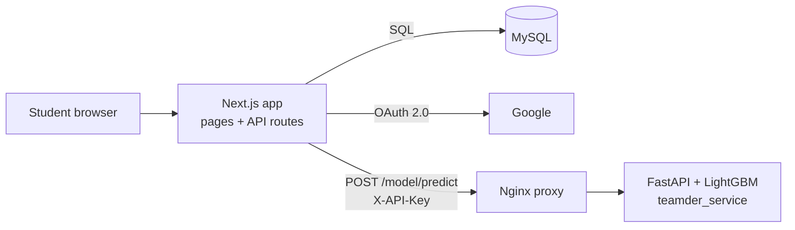

# TeamDER — Web App

**AI-powered teammate matching for university students.**
Find project teams whose working styles and skills actually fit yours, without having to walk up to strangers.

TeamDER is a full-stack Next.js application. Students take a short personality and decision-making assessment, browse open team projects, and see an AI-generated **match percentage** for each team before they apply. This repository is the web application (UI + API routes). The machine-learning model runs in a separate service: [`teamder_service`](https://github.com/tanakorn104/teamder_service).

> Built by **TeamDER** for the **KU AI Pioneers: Forward Challenge** (Kasetsart University, theme *"AI for Gen Z Lifestyle @KU"*).

---

## The problem

Kasetsart University is large and spread across many faculties. Many Gen Z students prefer privacy and online interaction, and find it hard to approach strangers to form a team for a project or activity. Finding teammates with matching interests, skills **and** working attitude is even harder across faculties.

TeamDER connects students through a recommendation approach that considers personality and work style, not just a shared topic.

## Features

- **Google sign-in** with automatic access-token refresh (OAuth 2.0)
- **Self-assessment** — Big Five personality (BFI) and Situational Judgment Test (leadership, planning, support)
- **Peer evaluation** — teammates rate each other after working together; peer scores are blended with self scores (Bayesian-style weighting, see below)
- **Project discovery feed** with three scopes: *Global*, *University* and *Subject* (by course code and section), plus filters by project type and free-text / tag search
- **AI match score** shown for each project, computed by the ML service from the current team plus the viewer
- **Create a team / project** with tags, visibility, recruiting status and target institution
- **Join requests** and member management (owner approves, members can leave)
- **My Team** dashboard with team stats and charts (Chart.js)
- **Profiles** with skills and Thai address data

## How the matching works

1. A user completes the BFI + SJT assessment → stored as `user_ai_features`.
2. After projects, teammates submit peer evaluations → stored in `peer_evaluations`.
3. The effective score for each trait blends self and peer ratings:

   ```
   w_peer = N / (N + K)        w_self = K / (N + K)        K = 3
   score  = self * w_self + peer * w_peer
   ```

   With no peer ratings the self score is used; with `N = 3` ratings both count equally.
4. For a project, the web app builds a payload (project tags, project type, and each member's traits and skill) and calls the AI service at `POST /model/predict`.
5. The service returns four predicted outcomes and an overall match percentage, which the UI displays on the project card.

See the service repository for model details.

## Architecture



## Tech stack

| Area | Technology |
| --- | --- |
| Framework | Next.js 16 (App Router), React 19, TypeScript |
| Styling | Tailwind CSS 4, DaisyUI, React Icons |
| Charts | Chart.js, react-chartjs-2 |
| Data | MySQL via `mysql2` |
| Auth | Google OAuth 2.0 (cookie-based tokens, refresh in middleware) |
| HTTP | Axios, `fetch` |
| AI service | FastAPI + LightGBM (separate repo) |
| Deployment | Vercel (web), Docker + Nginx (AI service) |

## Project structure

```
src/
├── app/
│   ├── page.tsx              # Home feed: project discovery + match scores
│   ├── auth/                 # Sign-in page
│   ├── prsnasmt/             # Personality / SJT self-assessment
│   ├── evaluate/             # Peer evaluation flow
│   ├── createteam/           # Create a team and add a project
│   ├── myteam/               # My teams, team detail and management
│   ├── project/[id]/         # Project detail and join requests
│   ├── profile/              # Own profile and public profiles
│   ├── components/           # BottomBar, Footer
│   └── api/                  # Route handlers
│       ├── auth/             # callback, me, logout
│       ├── home/             # Feed query + AI match scores
│       ├── myteam/ project/  # Team and project management
│       ├── evaluate/ prsnasmt/  # Assessments
│       ├── profile/ tags/ institutions/
│       └── test/             # Dev-only DB and model checks
├── data/roles.json           # Role / job-title options
├── lib/                      # db connection, server utilities
└── proxy.ts                  # Route protection + token refresh
```

## Getting started

### Prerequisites

- Node.js 20+
- A MySQL database (the schema is not included in this repository)
- A Google OAuth client (Web application) with the redirect URI below
- The AI service running and reachable (see [`teamder_service`](https://github.com/tanakorn104/teamder_service))

### 1. Install

```bash
git clone https://github.com/tanakorn104/teamder.git
cd teamder
npm install
```

### 2. Configure environment

Copy the template and fill in your own values:

```bash
cp .env.example .env.local
```

| Variable | Purpose |
| --- | --- |
| `DB_HOST`, `DB_PORT`, `DB_USER`, `DB_PASS`, `DB_NAME` | MySQL connection |
| `GOOGLE_CLIENT_ID_AUTH`, `GOOGLE_CLIENT_SECRET_AUTH` | Google OAuth credentials |
| `GOOGLE_RedirectCallBackURL_AUTH` | OAuth redirect, e.g. `http://localhost:3000/api/auth/callback` |
| `TeamderNginxServiceURI` | Base URL of the Nginx proxy in front of the AI service |
| `lightGBM_X_API_KEY` | API key sent as `X-API-Key` to the AI service |
| `NEXT_PUBLIC_VERSION` | App version label shown in the UI |


### 3. Run

```bash
npm run dev      # http://localhost:3000
npm run build    # production build
npm run start    # serve the production build
npm run lint
```

### Database

The app expects these tables: `users`, `user_profiles`, `user_ai_features`, `peer_evaluations`, `institutions`, `projects`, `project_members`, `project_tags`, `tags`, `join_requests`, plus question banks used by the assessments (`questions`, `questionsReport`, `rankedquestions`).

## Security notes

- All pages except `/auth` and `/api/auth/*` require a valid session cookie (`proxy.ts`).
- The AI service is private: only requests carrying a valid `X-API-Key` pass through Nginx.
- Secrets live in environment variables only.

## Roadmap

- Replace the hash-based tag vector with semantic text embeddings
- Add automated tests and a database migration/seed script
- Add screenshots and a live demo link to this README
- Support KU All Login as a sign-in option (proposed in the original concept)

## Team

**TeamDER** — Kasetsart University (Kamphaeng Saen campus and Bangkhen campus; Computer Engineering and Computer Science)

- Thanakorn Phromlek — Team Leader
- Thanakrit Wanmee
- Natthinan Chula
- Phangphuai Lungjing

## Related

- AI service: [`tanakorn104/teamder_service`](https://github.com/tanakorn104/teamder_service)

